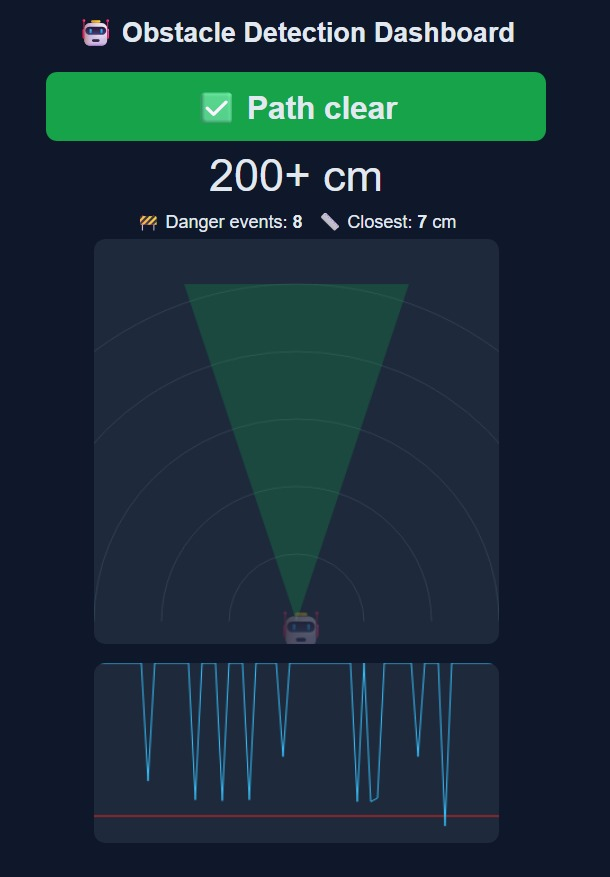
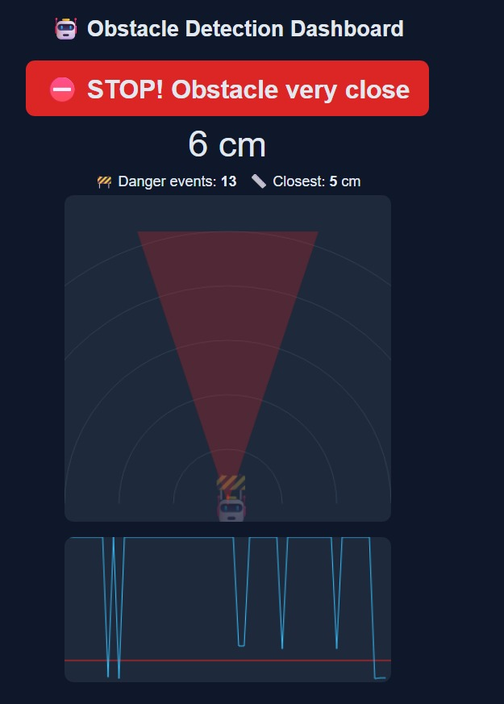
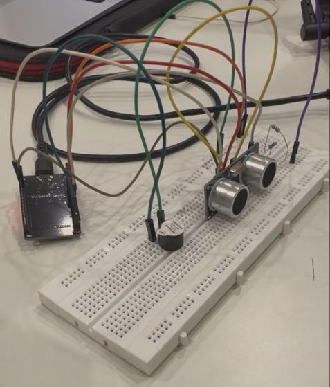
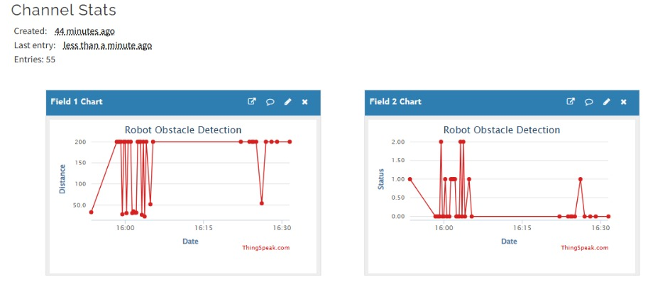
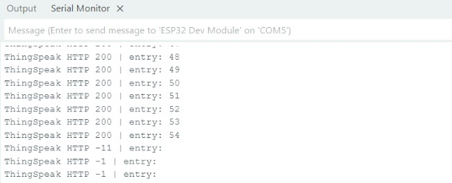

# IoT Obstacle Detection System (ESP32 + Ultrasonic Sensor + ThingSpeak)

A group project for **Internet of Things (Cloud/Edge)**, Thapar Institute of Engineering and Technology.

An ESP32 measures the distance to obstacles with an HC-SR04 ultrasonic sensor, decides **safe / warning / danger** on the device (edge), sounds a buzzer in the danger zone, uploads readings to the **ThingSpeak** cloud, and serves a **live web dashboard** with robot and obstacle icons.

| Dashboard: path clear | Dashboard: obstacle close |
|---|---|
|  |  |

## How it works
- **Edge (ESP32):** reads the sensor about 10 times per second and sets the status, so the buzzer reacts instantly even without internet. It also hosts the dashboard on the local network.
- **Cloud (ThingSpeak):** distance and status are uploaded every 16 seconds for history graphs.
- Distance (cm) = (echo time in µs × 0.034) / 2

| Distance | Status | Dashboard | Action |
|---|---|---|---|
| 60 cm or more | 0 Safe | Green | None |
| 30 to 60 cm | 1 Warning | Yellow | Yellow alert |
| Under 30 cm | 2 Danger | Red | Buzzer + obstacle icon |

The decision logic is a simple threshold rule, not machine learning.

## Hardware
ESP32 dev board, HC-SR04 ultrasonic sensor, active buzzer, 3 resistors (7.6 kΩ) for the Echo voltage divider, breadboard and jumper wires, phone hotspot (2.4 GHz).

| Part | ESP32 pin |
|---|---|
| HC-SR04 VCC | VIN (5 V) |
| HC-SR04 GND | GND |
| HC-SR04 TRIG | GPIO 5 |
| HC-SR04 ECHO | Resistor, then GPIO 18 (divider to GND) |
| Buzzer (+) / (-) | GPIO 23 / GND |

The Echo pin outputs 5 V but ESP32 pins tolerate only 3.3 V, so one resistor goes between Echo and GPIO 18 and two in series go from GPIO 18 to GND.

## Setup
1. Install **Arduino IDE** and add the ESP32 board package (Espressif).
2. Create a free **ThingSpeak** channel with Field 1 = Distance and Field 2 = Status. Copy its **Write API Key**.
3. Open `obstacle_detection.ino` and edit the 3 lines at the top: hotspot name, hotspot password, Write API Key.
4. Select **ESP32 Dev Module**, choose the port, and upload (hold the BOOT button if it says "Connecting...").
5. Open the Serial Monitor at 115200 baud and note the IP address it prints.
6. Connect your laptop to the same hotspot and open that IP in a browser.

## Results

## Limitations
- Needs a stable WiFi connection; uploads sometimes fail (HTTP -1 / -11) if the hotspot drops.
- Soft or angled surfaces cause spikes to 200 cm.
- The dashboard works only on the same WiFi network as the ESP32.

## Future work
Motorised car with automatic stop (L298N), servo sweep for a 180° radar view, DHT11 temperature correction, phone alerts.

## Team
Group of 6 students. Add names here.

The 2-page report is in [`report/`](report/).
